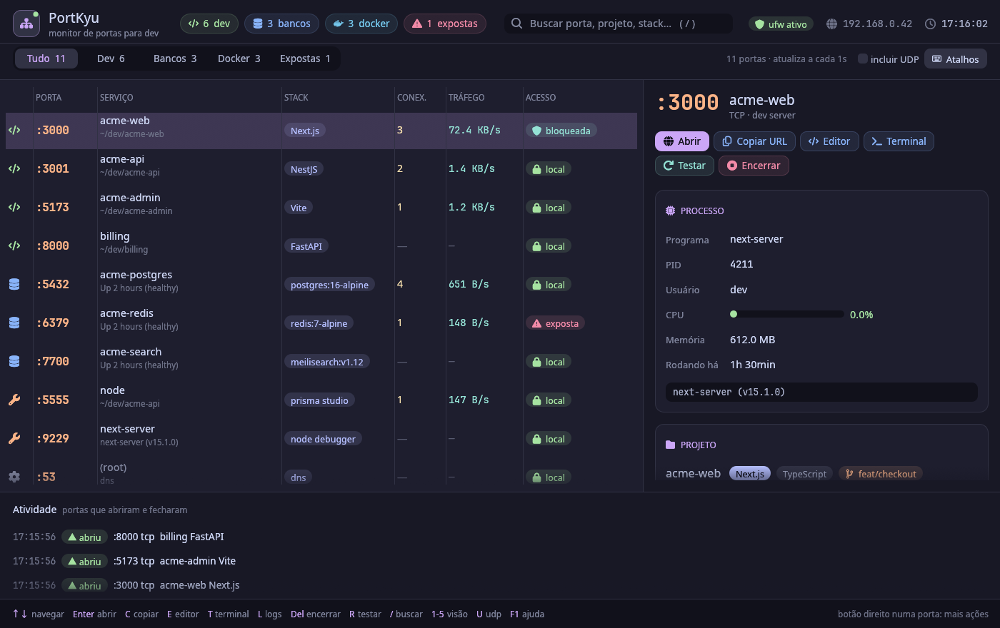

<p align="center">
  
</p>

<h1 align="center">PortKyu</h1>

<p align="center">
  <b>A port monitor built for developers.</b><br>
  See in real time which ports are open, <i>which project</i> is behind each one, its framework, Docker containers,
  traffic, who is connected and whether the port is exposed to the network.
</p>

<p align="center">
  <a href="README.md">🇧🇷 Português</a> · 🇺🇸 English
</p>

<p align="center">
  <a href="https://github.com/RafaelProfMgz/portkyu/releases/latest"></a>
  
  
  <a href="LICENSE"></a>
</p>

<p align="center">
  
  <br><sub>Screenshot with fake data (<code>portkyu --demo</code>). The interface is currently in Portuguese — i18n contributions are welcome!</sub>
</p>

---

## Features

| | |
|---|---|
| 🧭 **Project per port** | Finds the project behind each process: name from `package.json`/`Cargo.toml`/`go.mod`, **framework** (Next.js, Vite, NestJS, Express, Hono, Astro, Nuxt, SvelteKit, FastAPI, Django, Phoenix, Axum…) and **git branch**. |
| 🐳 **Docker** | Lists containers with image, status and published ports — straight from the API, without waking up a stopped daemon. |
| 🛡️ **Network exposure** | Tells whether a port is local only, blocked by `ufw`, allowed, or **exposed** — including the classic Docker case of publishing on `0.0.0.0` and bypassing the firewall. |
| ⚡ **HTTP probe** | Sends `GET /` to each dev server: status, response time, server (`x-powered-by`) and the page `<title>`. |
| 📈 **Traffic** | Per-port throughput with a live chart, connected clients (local × network), bytes sent/received and latency. |
| 🔗 **Talks to** | Where the process connects — `postgres :5432 ×3`, `redis :6379`, external APIs. |
| 🗂️ **Categories** | Dev · Databases · Tools (debugger, Prisma Studio, Supabase) · System, with filters and search. |
| 🕒 **Activity** | Log of ports opening and closing (great for watching `pnpm dev` come up or crash). |
| 🖱️⌨️ **Keyboard and mouse** | Native GUI (Wayland/X11) with shortcuts for everything, right-click menu, plus a terminal UI (`--tui`). |

One click or key away: **open in browser**, **copy URL**, **open project in editor**, **terminal in project folder**,
**container logs** and **kill process / stop container** (with confirmation).

---

## Install

> Requirements: Linux x86_64. Per-connection traffic uses `ss` (`iproute2`, shipped by every distro).

### Option 1 — AppImage (nothing to install)

Download `PortKyu-x.y.z-x86_64.AppImage` from **[Releases](https://github.com/RafaelProfMgz/portkyu/releases/latest)**, then:

```bash
chmod +x PortKyu-*-x86_64.AppImage
./PortKyu-*-x86_64.AppImage
```

> FUSE error? `sudo apt install libfuse2` (Ubuntu/Debian) **or** run with `--appimage-extract-and-run`.

### Option 2 — Installer (app menu + icon + shortcut)

```bash
curl -fsSL https://raw.githubusercontent.com/RafaelProfMgz/portkyu/main/install.sh | bash
```

Installs to `~/.local/bin/portkyu` (no `sudo`). On **KDE Plasma** the global shortcut `Meta+Shift+P` is registered
automatically. Uninstall with `… | bash -s -- --uninstall`.

### Option 3 — Build from source

```bash
git clone https://github.com/RafaelProfMgz/portkyu.git
cd portkyu
./install.sh          # builds in release mode and installs
```

Requires a recent stable [Rust](https://rustup.rs).

---

## Usage

```text
portkyu              open the window
portkyu 3000         open with port 3000 selected
portkyu --tui        terminal UI (handy over ssh or with sudo)
portkyu -l           print once and exit (for grep/scripts)
portkyu -u           include UDP ports
portkyu --admin      open a terminal running the TUI as root
portkyu --demo       fake data — explore the UI or take screenshots
```

| Key | Action |
|---|---|
| `↑` `↓` / `J` `K` | navigate |
| click / double click | select / open in browser |
| right click | all actions for the port |
| `Enter` / `O` | open `http://localhost:port` |
| `C` · `E` · `T` · `L` | copy URL · editor · terminal · container logs |
| `Del` / `X` | kill process / stop container (asks first) |
| `R` | re-run HTTP probe |
| `/` / `Ctrl+F` | search · `Esc` clears |
| `1`…`5` | All · Dev · Databases · Docker · Exposed |
| `U` · `F1` · `Ctrl+Q` | UDP · help · quit |

Without root, Linux only reveals socket owners for **your** user; system processes show as `(root)`.
Use `portkyu --admin` (or `sudo portkyu --tui`) to see everything.

### Security tip: Docker × firewall

If a container is flagged **exposed**, any device on your network can reach it even with `ufw` enabled. Publish to
localhost only:

```yaml
ports:
  - "127.0.0.1:5432:5432"   # instead of "5432:5432"
```

---

## Contributing

Contributions are very welcome! Read the **[contributing guide](CONTRIBUTING.md)** (Portuguese, but issues and PRs in
English are fine), pick a [`good first issue`](https://github.com/RafaelProfMgz/portkyu/labels/good%20first%20issue)
or join the [Discussions](https://github.com/RafaelProfMgz/portkyu/discussions). Security reports: [SECURITY.md](SECURITY.md).

```bash
cargo run --release -- --demo   # UI with fake data, no services needed
```

## License

[MIT](LICENSE). UI icons: [Nerd Fonts Symbols](https://github.com/ryanoasis/nerd-fonts) (MIT), embedded in `assets/fonts`.
