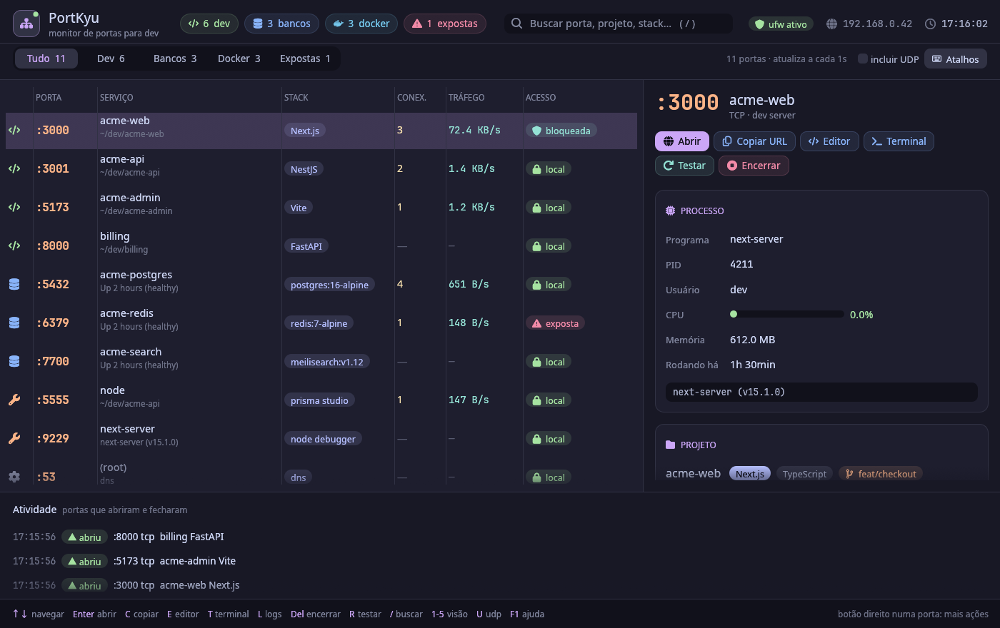

<p align="center">
  
</p>

<h1 align="center">PortKyu</h1>

<p align="center">
  <b>Monitor de portas para quem desenvolve.</b><br>
  Veja em tempo real quais portas estão abertas, <i>qual projeto</i> está em cada uma, o framework, os containers Docker,
  o tráfego, quem está conectado e se a porta está exposta na rede.
</p>

<p align="center">
  🇧🇷 Português · <a href="README.en.md">🇺🇸 English</a>
</p>

<p align="center">
  <a href="https://github.com/RafaelProfMgz/portkyu/releases/latest"></a>
  
  
  <a href="LICENSE"></a>
</p>

<p align="center">
  
  <br><sub>Captura com dados fictícios (<code>portkyu --demo</code>).</sub>
</p>

---

## O que ele faz

| | |
|---|---|
| 🧭 **Projeto por porta** | Descobre o projeto de cada processo: nome do `package.json`/`Cargo.toml`/`go.mod`, **framework** (Next.js, Vite, NestJS, Express, Hono, Astro, Nuxt, SvelteKit, FastAPI, Django, Phoenix, Axum…) e **branch do git**. |
| 🐳 **Docker** | Lista containers com imagem, status e portas publicadas — direto pela API, sem acordar o daemon se ele estiver parado. |
| 🛡️ **Exposição na rede** | Mostra se a porta é só local, bloqueada pelo `ufw`, liberada, ou **exposta** — inclusive o caso clássico do Docker publicando em `0.0.0.0` e ignorando o firewall. |
| ⚡ **Teste HTTP** | Faz um `GET /` em cada servidor dev: status, tempo de resposta, servidor (`x-powered-by`) e o `<title>` da página. |
| 📈 **Tráfego** | Velocidade por porta com gráfico ao vivo, clientes conectados (local × rede), bytes enviados/recebidos e latência. |
| 🔗 **Com quem fala** | Para onde o processo se conecta — `postgres :5432 ×3`, `redis :6379`, APIs externas. |
| 🗂️ **Categorias** | Dev · Bancos · Ferramentas (debugger, Prisma Studio, Supabase) · Sistema, com filtros e busca. |
| 🕒 **Atividade** | Registro das portas que abriram e fecharam (ótimo para ver o `pnpm dev` subindo ou caindo). |
| 🖱️⌨️ **Teclado e mouse** | Interface gráfica nativa (Wayland/X11) com atalhos para tudo, menu de botão direito e uma versão de terminal (`--tui`). |

Ações em um clique ou uma tecla: **abrir no navegador**, **copiar a URL**, **abrir o projeto no editor**,
**terminal na pasta do projeto**, **logs do container** e **encerrar processo / parar container** (com confirmação).

---

## Instalação

> Requisitos: Linux x86_64. Para o tráfego por conexão usa o `ss` (pacote `iproute2`, já vem em todas as distros).

### Opção 1 — AppImage (sem instalar nada)

1. Baixe o `PortKyu-x.y.z-x86_64.AppImage` em **[Releases](https://github.com/RafaelProfMgz/portkyu/releases/latest)**.
2. Dê permissão e rode:

```bash
chmod +x PortKyu-*-x86_64.AppImage
./PortKyu-*-x86_64.AppImage
```

> Se aparecer erro de FUSE: `sudo apt install libfuse2` (Ubuntu/Debian) **ou** rode com
> `./PortKyu-*.AppImage --appimage-extract-and-run`.
> Para integrar ao menu de aplicativos, use o [Gear Lever](https://flathub.org/apps/it.mijorus.gearlever) ou a opção 2.

### Opção 2 — Instalador (menu de aplicativos + ícone + atalho)

Baixa o binário pronto da última release e instala para o seu usuário (sem `sudo`):

```bash
curl -fsSL https://raw.githubusercontent.com/RafaelProfMgz/portkyu/main/install.sh | bash
```

Instala em `~/.local/bin/portkyu`, cria o atalho no menu e o ícone. No **KDE Plasma** o atalho global
`Meta+Shift+P` é registrado automaticamente; em outros ambientes, configure um atalho para o comando `portkyu`.

### Opção 3 — Compilar do código-fonte

Precisa do [Rust](https://rustup.rs) estável e recente (`rustup update`):

```bash
git clone https://github.com/RafaelProfMgz/portkyu.git
cd portkyu
./install.sh          # compila em modo release e instala
```

Ou só compilar: `cargo build --release` → `target/release/portkyu`.

### Desinstalar

```bash
curl -fsSL https://raw.githubusercontent.com/RafaelProfMgz/portkyu/main/install.sh | bash -s -- --uninstall
# ou, dentro do repositório: ./install.sh --uninstall
```

---

## Uso

```text
portkyu              abre a janela
portkyu 3000         abre já com a porta 3000 selecionada
portkyu --tui        versão de terminal (útil via ssh ou com sudo)
portkyu -l           lista uma vez e sai (bom para grep/scripts)
portkyu -u           inclui portas UDP
portkyu --admin      abre um terminal rodando a versão de terminal como root
portkyu --demo       dados fictícios — para conhecer a interface ou tirar capturas
sudo portkyu --tui   mostra processos de root e as regras exatas do ufw
```

### Atalhos

| Tecla | Ação |
|---|---|
| `↑` `↓` / `J` `K` | navegar (PgUp/PgDn, Home/End) |
| clique / duplo clique | selecionar / abrir no navegador |
| botão direito | menu com todas as ações da porta |
| `Enter` / `O` | abrir `http://localhost:porta` |
| `C` | copiar a URL |
| `E` | abrir a pasta do projeto no editor (VSCodium, Cursor, VS Code, Zed… ou nvim) |
| `T` | abrir um terminal na pasta do projeto |
| `L` | logs ao vivo do container |
| `Del` / `X` | encerrar processo / parar container (pede confirmação) |
| `R` | testar HTTP de novo |
| `/` / `Ctrl+F` | buscar por porta, projeto, stack ou comando · `Esc` limpa |
| `1`…`5` | Tudo · Dev · Bancos · Docker · Expostas |
| `U` | incluir portas UDP |
| `F1` / `?` | ajuda |
| `Ctrl+Q` | sair |

### Sobre permissões

Sem root, o Linux só mostra o dono dos sockets do **seu** usuário — processos do sistema aparecem como `(root)` e as
regras exatas do `ufw` não podem ser lidas. Para ver tudo, use `portkyu --admin` (ou `sudo portkyu --tui`).
A interface gráfica não roda como root de propósito (Wayland não permite e não é seguro).

### Dica de segurança: Docker × firewall

Se o PortKyu marcar um container como **exposta**, ele está acessível por qualquer aparelho da rede, mesmo com o
`ufw` ativo (o Docker cria regras próprias no iptables). Para publicar só na sua máquina:

```yaml
# docker-compose.yml
ports:
  - "127.0.0.1:5432:5432"   # em vez de "5432:5432"
```

Ou, para todos os containers, em `/etc/docker/daemon.json`: `{ "ip": "127.0.0.1" }` e `sudo systemctl restart docker`.

---

## Contribuindo

O PortKyu é open source e contribuições são muito bem-vindas — de relatos de bug a novos recursos.
Leia o **[guia de contribuição](CONTRIBUTING.md)**, veja as
[issues `good first issue`](https://github.com/RafaelProfMgz/portkyu/labels/good%20first%20issue) e participe das
[Discussions](https://github.com/RafaelProfMgz/portkyu/discussions). Vulnerabilidades: veja [SECURITY.md](SECURITY.md).

## Desenvolvimento

```bash
cargo run --release -- --demo  # interface com dados fictícios
cargo run --release            # interface gráfica
cargo run --release -- --tui   # interface de terminal
./scripts/build-appimage.sh    # gera dist/*.AppImage e dist/*.tar.gz
```

Estrutura:

```text
src/
├── main.rs       argumentos e modos (gui, tui, lista)
├── app.rs        estado, classificação, eventos e ações (independente de interface)
├── gui.rs        interface gráfica (egui/eframe)
├── tui.rs, ui.rs interface de terminal (ratatui)
├── collect.rs    sockets e processos via /proc
├── project.rs    detecção de projeto, framework e branch
├── docker.rs     API do Docker pelo socket Unix
├── firewall.rs   estado do ufw e classificação de exposição
├── probe.rs      teste HTTP em segundo plano
└── traffic.rs    bytes por conexão (tcp_info via ss)
```

Para publicar uma versão: atualize `version` no `Cargo.toml`, faça commit e crie a tag:

```bash
git tag v1.1.0 && git push origin v1.1.0
```

O GitHub Actions compila no Ubuntu 22.04 (compatível com glibc 2.35+) e anexa o AppImage e o tarball à release.

---

## Licença

[MIT](LICENSE). Ícones da interface: [Nerd Fonts Symbols](https://github.com/ryanoasis/nerd-fonts) (MIT), embutidos em `assets/fonts`.
